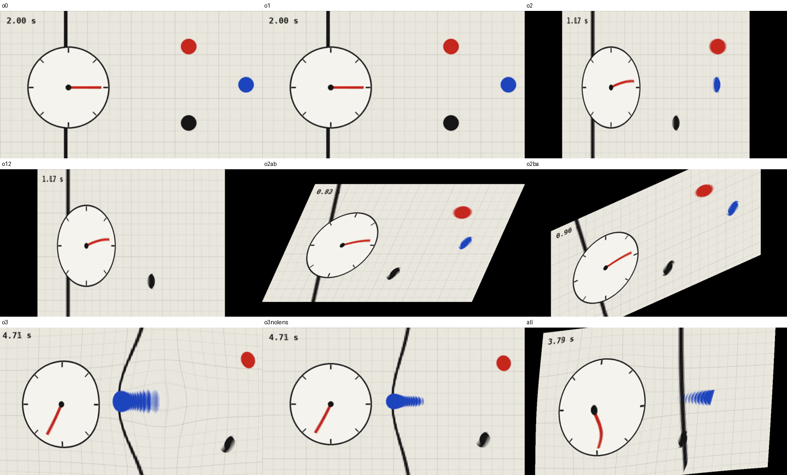

# spacetime/1 — the (x, y, t) cube under three operations

Experimental. Created 2026-10-19. Screen `/screen/spacetime/1`; one phone link
per operation: `/mobile/spacetime/1/compact` (O1), `/mobile/spacetime/1/boost`
(O2), `/mobile/spacetime/1/mass` (O3). Browser runtime on real devices is
**unverified**; renders were checked headlessly (below).

## Tested relation

A moving image is a cube (x, y, t); the screen normally shows its xy slice
advancing in t. Here that **reading rule stays fixed** — one slice, the
present at the screen centre — and phones change only the cube's geometry.
This is Banpo-Xism's structure (fixed price rule `P`, deformed field, value
read from the projection) moved from the L–B plane to a moving image. Each
operation is a metric/topology change with a physical source rather than a
free deformation:

| Op | Link | Geometry | Phone input | Multi-phone rule |
| --- | --- | --- | --- | --- |
| O1 | compact | space becomes a flat torus (x ~ x + L, y ~ y + L): the scene repeats, and copy (i, j) is seen \|(i, j)·L\|/C s in the past (cosmic-topology ghost images). Flat locally; only topology changes | vertical drag | one shared value, last writer, persists |
| O2 | boost | Lorentz boost of the observer: its "now" tilts by γβ/C s per frame height and the scene contracts by 1/γ | tilt from the enabling pose → velocity (`orientation.mjs`) | each phone is one observer; boosts chain in joining order; non-collinear boosts do not commute (Thomas–Wigner) |
| O3 | mass | weak-field metric: static clocks run at √(1 − 2Σμ/ρ); lag ∫(1 − rate)dt accumulates and never decays; softened point-mass lensing | press-and-hold places a mass that grows while held | potentials add; masses persist until the screen resets |

The constants (C = 0.6 frame heights/s, MAX_BETA 0.85, softening 0.22,
lens gain 0.15, …) sit at the top of
`socket/experiments/spacetime/1/physics.mjs`.

## Structure

- `socket/experiments/spacetime/1/` — `physics.mjs` (shared pure physics),
  `orientation.mjs` (tilt → β, shared with the boost phone), `model.mjs`
  (relay runtime: compactness, observer chain, masses, time), `index.mjs`
  (registration, C-VAL's join/hello/presence pattern, events `spacetime-1:*`,
  room `experiment:spacetime:1`), tests beside each.
- `components/spacetime/1/` — `model/` (snapshot mirror), `transport/` (sole
  socket boundary), `media/` (clip registry/loader), `render/` (one WebGL2
  full-screen pass), `screen/` (`presenter.ts` derives a frame from snapshot
  + time, once-only smoothing; `settings.ts` author options), `mobile/<op>/`
  (`index.tsx` logic, `view.tsx` view, C-VAL's split) on a shared `mobile/stage.tsx`:
  title + one-line explanation, a **live preview of the shared screen**
  (`render/use-spacetime-canvas.ts`, the same renderer), and the control.
  O3 is pressed directly on the preview (`clipPointAt` inverts O2/O1).
- Clips: `scripts/build-atlas.sh <video> <id>` writes
  `public/media/spacetime/<id>/{atlas.jpg, manifest.json}` (16:9, 480×270,
  24 fps, ≤ 8 s); add the id to `components/spacetime/1/media/index.ts`.
  `media/make-synthetic-loop.py` regenerates the calibration clip
  (`synthetic-loop`: static camera, loopable, grid + clock + three balls +
  sweeping bar, every motion periodic in 8 s).

The screen's bottom-right control toggles O1/O2/O3/lens to isolate each
operation against the plain clip, switches clips, and resets compactness and
masses. It is author chrome, not participant UI.

## Invariants

- Phones send raw values; the screen smooths once (`SCREEN_SMOOTHING_PER_SECOND`).
- The relay owns operations and time; browsers derive all visuals. Exception:
  the O3 lag field is integrated by the open screen page (it is reset to zero
  when the relay reports no masses after having some; a screen reload loses it).
- A departed observer decays to rest and leaves the chain (no jump).
- Outside the scene is black: a boosted or lensed view can see past the frame.

## Observed (headless Chromium/SwiftShader, 2026-10-19)

- O1 alone is invisible within one period: it only shortens the loop. It
  becomes visible only through O2/O3, when a tilted or lagged slice crosses
  the seam of the time circle (windings). This is the honest difference from
  Banpo-Xism's O1, whose torus changed the *embedding* and was visible alone.
- O2 reads clearly: the clock hand bends (left of centre is earlier), the
  scene contracts. `o2ab` vs `o2ba` (same two boosts, swapped order) differ
  by a shear/rotation — the non-commutation is visible.
- O3 bends the sweeping bar around the mass and stretches the passing ball
  into a slit-scan trail; lensing pinches the grid. Without lensing the time
  effect alone remains legible.

## Revision 2026-10-19 (same day, after the first real run)

The first run failed in use: phones showed bare circles with no visible
consequence, and O1 (then a time circle) changed nothing on screen by itself.
Changes: O1 became compact *space* (visible alone as aged copies); every
phone now shows the live screen; O3 grows faster (0.05/s) and lenses
harder (gain 0.3); the compact phone no longer resends a stale 0 on release.
Checked in a real browser against the running relay: compact drag →
screen 85 % tiles; boost drag → tilted, contracted tiles on screen and
phone; mass press → bent bar and lensing around the press point.
The relay must be restarted for the new mass growth rate (`physics.mjs`).

## Unresolved

- Real-phone feel of the tilt mapping (`TILT_SCALE_DEGREES` 28°) and of C.
- No second wrapper yet for Banpo's "projected value" (e.g. a screen that reads
  out the local time / year each region shows). The GenAI clip and the
  socio-political reading are still open.
